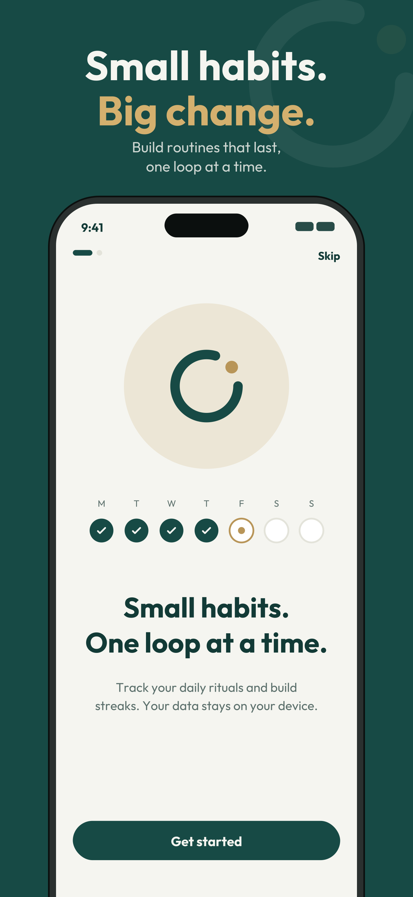
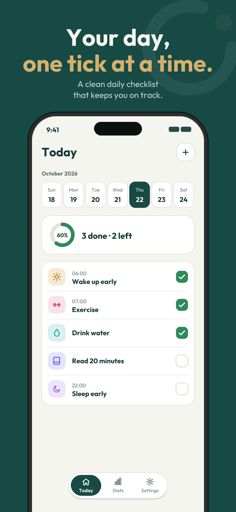
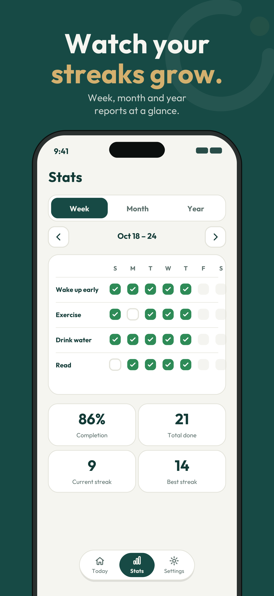
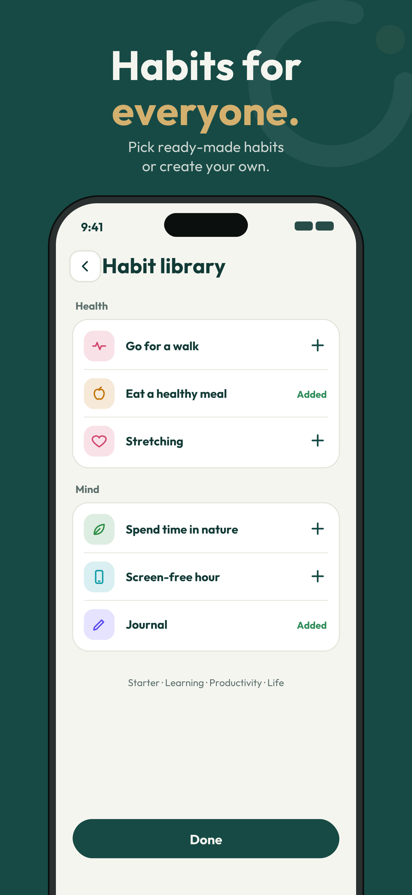
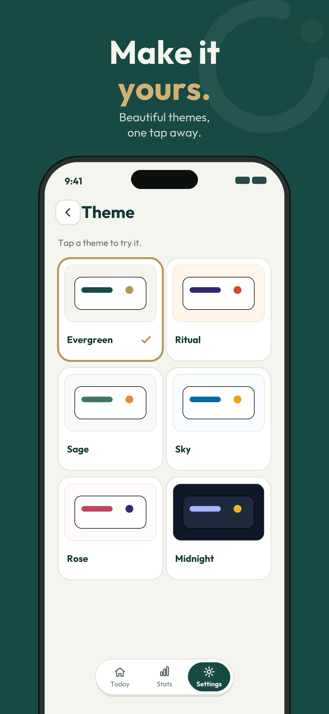
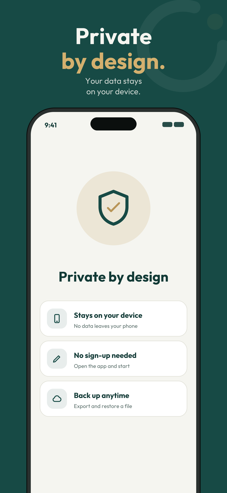

# RitualLoop

A simple habit and routine tracker that keeps all your data on your device.

## Overview

RitualLoop helps you build habits and stay consistent with daily routines. There are no accounts, no cloud, and no syncing. Everything is stored locally and works fully offline.

## Features

- Create and track habits and routines
- Local reminder notifications
- Export and import your data
- Private by design: all data stays on your device

## Screenshots

  
  
  
  
  
  

## Download

Download the latest APK from the [Releases page](https://github.com/zynlolabs/RitualLoop-Habit_Tracker/releases/latest).

**Installation**

1. Download `RitualLoop-v1.0.0.apk`.
2. Open the file and allow **Install unknown apps** if prompted.
3. Tap **Install**.

Currently available for Android only.

## Privacy

RitualLoop does not collect, transmit, or sync any personal data. See the [Privacy Policy](https://plastic-koi-504.notion.site/Privacy-Policy-for-RitualLoop-2cad1c9a5c7b82acac6481a693e1a073?source=copy_link) for details.

## Support

Found a bug or have a suggestion? [Open an issue](https://github.com/zynlolabs/RitualLoop-Habit_Tracker/issues) or email [zynlolabs@gmail.com](mailto:zynlolabs@gmail.com).

---

Developed by **Zynlo Labs**
